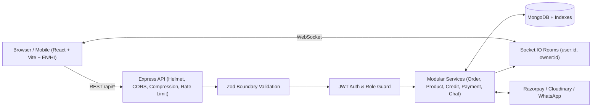

# Bangels Verse — Handcrafted Heritage Bangles Marketplace

A production-grade, full-stack **MERN** e-commerce marketplace built for Indian handcrafted bangles (Jaipur Lac, Kundan, 22K Gold-Plated, Firozabad Velvet Glass, Bridal Chooda, Silver Kada, and Everyday Rose Gold).

This project is engineered around one real-world design constraint: **many end customers are first-time or non-tech-savvy mobile shoppers who do not use email IDs, complex passwords, or multi-page checkout funnels.** Every UX flow and backend API was rebuilt so anyone can browse, choose a bangle size, and place an order in **under 30 seconds** — while still giving Shop Owners and Admins real-time analytics, inventory protection, and Khata (credit) ledger management.

---

## Table of Contents

1. [Project Overview & Problem Statement](#1-project-overview--problem-statement)
2. [Tech Stack](#2-tech-stack)
3. [System Architecture](#3-system-architecture)
4. [Folder Structure](#4-folder-structure)
5. [Database Design & Models](#5-database-design--models)
6. [Feature Implementation Details](#6-feature-implementation-details)
7. [Security & Performance Optimizations](#7-security--performance-optimizations)
8. [REST API Reference](#8-rest-api-reference)
9. [Local Setup & Testing](#9-local-setup--testing)
10. [Production Deployment Modes](#10-production-deployment-modes)
11. [Interview Explanation & Q&A Guide](#11-interview-explanation--qa-guide)

---

## 1. Project Overview & Problem Statement

### The Business Problem
Traditional jewelry marketplaces force buyers to create accounts with email + strong password, verify OTPs, navigate confusing dropdowns, and complete multi-step checkouts. For local buyers, elders, or small-town customers ordering bangles on affordable Android phones, that friction causes drop-offs.

### How Bangels Verse Solves It
Bangels Verse supports **three user roles** (`Customer`, `Shop Owner`, `Admin`) plus a **zero-login buyer experience**:

- **For Non-Tech-Savvy Customers:**
  - **1-Tap Quick Order (No Login Required):** Tap **Order Now**, pick bangle size (`2.2`–`2.10`) and quantity, enter only **Name, 10-Digit Mobile, and Address**, and confirm with **Cash on Delivery**.
  - **Instant Bilingual Switch (`English` / `हिन्दी`):** 1-tap toggle translates navigation, product names (`nameHi`), size guide, buttons, checkout, and order tracking.
  - **Zero-Login Order Tracking (`/track-order`):** Check live order status using only a mobile number or short order code (e.g., `BV-4821`).
  - **Visual Bangle Size Guide:** Interactive ruler diagram explaining how to measure inner bangle diameter in centimeters and inches.
  - **WhatsApp & Click-to-Call Fallback:** Pre-filled WhatsApp order messages and direct shop phone support on every product.
  - **Phone-First Accounts & Shop Khata:** Optional accounts work with mobile number + 4-digit PIN (no email required for buyers), with a built-in Khata (Udhaar / buy-now-pay-later) ledger.

- **For Artisan Shop Owners:**
  - Dedicated dashboard (`/owner/dashboard`) with 7-day sales visualization, low-stock alerts, bilingual catalog manager, real-time Socket.IO order alerts, 1-click fulfillment status updates (`confirmed → packed → shipped → delivered`), payout tracking, and customer Khata cash settlement.

- **For Platform Admins:**
  - Full control panel (`/admin/dashboard`) for shop approval/rejection, platform GMV stats, owner/customer summaries, order monitoring, coupons, announcements, categories, payouts, and activity logs.

---

## 2. Tech Stack

### Frontend
| Technology | Version | Purpose |
|---|---|---|
| **React** | `^18.2.0` | Component-based SPA UI with `Suspense` + `React.lazy` route splitting |
| **Vite** | `^5.0.0` | Fast ES-module bundler and dev server with `/api` proxy |
| **Tailwind CSS** | `^3.3.6` | Custom **Jaipur Kundan & Ivory** design system (`ivory`, `linen`, `ink`, `sindoor`, `brass`) |
| **React Router DOM** | `^6.20.0` | Client-side routing with role-guarded routes (`ProtectedRoute`) |
| **Axios** | `^1.6.2` | HTTP client with JWT request interceptor and global `401` handling |
| **Socket.IO Client** | `^4.7.2` | Real-time order alerts, status updates, and buyer-shop chat |
| **Lucide React** & **React Icons** | `^1.x` / `^4.12.0` | Crisp, consistent vector iconography (zero emoji placeholders) |
| **React Hot Toast** | `^2.4.1` | Non-blocking feedback notifications |

### Backend
| Technology | Version | Purpose |
|---|---|---|
| **Node.js** | `v22` | Runtime + native `node:test` integration test runner |
| **Express.js** | `^4.18.3` | Modular REST API + static frontend serving in unified mode |
| **MongoDB & Mongoose** | `^7.5.2` | Document storage with compound/text/sparse indexes and atomic updates |
| **Socket.IO** | `^4.8.3` | Authenticated user/owner/admin notification rooms + chat rooms |
| **Zod** | `^4.x` | Boundary request schema validation (`422` structured error details) |
| **JWT (`jsonwebtoken`)** | `^9.0.0` | Stateless 14-day bearer authentication |
| **bcryptjs** | `^2.4.3` | Salted password/PIN hashing (12 rounds) |
| **Helmet, Compression, Rate Limit** | `^8.x` / `^1.8.x` | Security headers, gzip/brotli compression, brute-force & spam throttling |
| **Razorpay SDK** | `^2.9.6` | Online UPI/card order creation + HMAC-SHA256 signature verification |
| **Cloudinary + Multer** | `^1.41.3` / `^2.1.1` | Image uploads (up to 5MB, MIME allowlisted) with local `/uploads` fallback |

### Infrastructure & Deployment
- **Docker** (multi-stage Alpine build) & **Docker Compose** (MongoDB 8 + App container)
- **Render Blueprint** (`render.yaml`) for unified single-service cloud hosting
- **Vercel Config** (`frontend/vercel.json`) for split SPA hosting

---

## 3. System Architecture



### Layered Backend Pattern (Modular Monolith)
Every domain inside `backend/src/modules/<feature>/` follows strict separation of concerns:
1. **`*.routes.js`**: Defines HTTP verbs, authentication (`isAuth`, `optionalAuth`, `authorizeRoles`), and `validate(zodSchema)` middleware at the system edge.
2. **`*.controller.js`**: Thin HTTP adapters wrapped in `asyncHandler` that extract request params/body/user and return uniform JSON (`{ success, data, message }`).
3. **`*.service.js`**: Pure business logic, atomic database updates, stock rollbacks, and socket/notification side effects.
4. **`*.model.js`**: Mongoose schema definitions and performance indexes.

### Request Flow Example (1-Tap Quick Order)
1. Buyer clicks **Order Now** on a bangle card -> `QuickOrderModal` opens (`LangContext`).
2. Buyer selects bangle size, quantity, Name, 10-digit Mobile, Address, and Cash on Delivery -> generates a client `Idempotency-Key`.
3. `POST /api/orders/quick` passes rate limiting (`strictLimiter`) and Zod validation (`quickOrderSchema`).
4. `order.service.js` normalizes the 10-digit phone, links or creates a customer `User` (`isQuickAccount: true`), atomically decrements `Product.stock`, calculates server-side totals, generates a unique `BV-XXXX` code, persists the `Order`, notifies every involved shop owner via DB `Notification` + targeted Socket.IO room (`owner:<id>`), and returns the confirmation receipt.

---

## 4. Folder Structure

```text
bangels verse/
├── .agents/                    # 25 engineering agent skills + checklists
├── package.json                # Root orchestration scripts (build, start, seed, test)
├── Dockerfile                  # Multi-stage production container (Frontend build + Node server)
├── docker-compose.yml          # Containerized MongoDB 8 + Bangels Verse app
├── render.yaml                 # Render unified web service blueprint
├── DEPLOYMENT.md               # Step-by-step cloud/VPS hosting runbook
│
├── backend/
│   ├── .env.example            # Safe environment variable template
│   ├── tests/
│   │   └── api.test.js         # End-to-end integration test suite (node:test)
│   └── src/
│       ├── app.js              # Express app, security middleware, routes, /api/health, SPA fallback
│       ├── server.js           # HTTP + Socket.IO server, MongoDB connect, auto-seed, graceful shutdown
│       ├── config/
│       │   ├── cloudinary.js   # Safe lazy Cloudinary init
│       │   ├── razorpay.js     # Safe lazy Razorpay init
│       │   ├── seedDemo.js     # Auto-seeds admin, flagship Jaipur owner, customer, and 8 bangles
│       │   └── socket.js       # Shared Socket.IO singleton (prevents circular imports)
│       ├── middleware/
│       │   ├── auth.middleware.js      # isAuth, optionalAuth, authorizeRoles
│       │   ├── error.middleware.js     # validate(schema), notFoundHandler, errorHandler
│       │   └── validate.middleware.js  # Boundary Zod validation export
│       ├── utils/
│       │   └── errors.js       # AppError class, asyncHandler, normalizePhone helper
│       └── modules/
│           ├── auth/           # Phone/email register, login, profile
│           ├── product/        # Bangle catalog, search, filters, categories summary, detail + related
│           ├── cart/           # Size-aware persistent cart CRUD
│           ├── order/          # Standard checkout, 1-tap quick order, public tracker, status, reorder
│           ├── payment/        # Razorpay create-order & HMAC signature verify
│           ├── credit/         # Shop Khata (Udhaar) ledger & cash settlement
│           ├── review/         # Verified star ratings & average recalculation
│           ├── notification/   # Unread counts, mark read, delete
│           ├── dashboard/      # Owner 7-day sales & low-stock aggregations
│           ├── admin/          # Platform stats, owner approvals, user summaries
│           ├── transaction/    # Financial audit trail
│           ├── upload/         # Cloudinary upload with local /uploads fallback
│           ├── wishlist/       # Saved products toggle/list
│           ├── address/        # Multi-address customer address book
│           ├── coupon/         # Promo code management & validation
│           ├── announcement/   # Platform banners
│           ├── category/       # Admin category management
│           ├── payout/         # Owner earnings & payouts
│           ├── chat/           # Real-time buyer <-> shop conversations
│           └── activityLog/    # Admin audit logs
│
└── frontend/
    ├── index.html              # Cormorant Garamond + Plus Jakarta Sans + Noto Sans Devanagari fonts
    ├── tailwind.config.js      # Custom Jaipur Atelier color palette & font tokens
    ├── vercel.json             # SPA rewrite rules for Vercel
    ├── public/images/          # Studio hero/artisan photography + 8 bespoke SVG product visuals
    └── src/
        ├── App.jsx             # Code-split routes (React.lazy) + Context providers + global modals
        ├── i18n/translations.js # English + Hindi dictionary
        ├── services/api.js     # Central Axios instance + API modules + resolveAssetUrl
        ├── context/            # AuthContext, CartContext, LangContext, WishlistContext
        ├── components/         # Navbar, Footer, ProductCard, QuickOrderModal, SizeGuideModal, UI, ErrorBoundary
        └── pages/              # Home, Products, ProductDetail, TrackOrder, Cart, Checkout,
                                # MyOrders, OrderDetail, Wishlist, AddressBook, Chat, Notifications,
                                # CreditHistory, TransactionHistory, Profile, OwnerDashboard, AdminDashboard
```

---

## 5. Database Design & Models

### Core Collections & Indexes
1. **`User` (`user.model.js`)**
   - Supports **email OR 10-digit mobile** registration using `unique: true, sparse: true` indexes on both `email` and `phone` (omitting empty values so phone-only buyers never collide).
   - Stores `role` (`"user" | "owner" | "admin"`), `isApproved` (for shop owners), `isQuickAccount`, `preferredLanguage` (`"en" | "hi"`), `addresses[]`, `companyName`, `whatsappNumber`, `upiId`.
   - Index: `{ role: 1, isApproved: 1 }`.

2. **`Product` (`product.model.js`)**
   - Bangle-specific attributes: `name`, `nameHi` (Hindi title), `price`, `compareAtPrice` (MRP for discount calculation), `category`, `material`, `occasion`, `sizes` (`["2.2", "2.4", "2.6", "2.8", "2.10", "Free Size"]`), `setCount`, `stock`, `image`, `images[]`, `isFeatured`, `isActive`, `averageRating`, `numReviews`.
   - Indexes: `{ isActive: 1, category: 1, createdAt: -1 }`, `{ owner: 1, createdAt: -1 }`, `{ price: 1 }`, `{ isFeatured: -1, averageRating: -1 }`, and full-text index on `{ name, nameHi, description, category, material }`.

3. **`Order` (`order.model.js`)**
   - Human-readable `orderCode` (e.g. `BV-4821A`), optional `user`, `customerName`, normalized `customerPhone`, `shippingAddress`, `items[]` (with price/name/image/size snapshots at purchase time), `owners[]` (supports multi-shop cart checkouts cleanly), `paymentType` (`"cash" | "online" | "credit"`), `status` (`"pending" | "confirmed" | "packed" | "shipped" | "paid" | "delivered" | "cancelled"`), `statusHistory[]`, `source` (`"cart" | "quick_order" | "whatsapp"`), and `idempotencyKey` (`unique: true, sparse: true`).
   - Indexes: `{ user: 1, createdAt: -1 }`, `{ owners: 1, createdAt: -1 }`, `{ customerPhone: 1 }`, `{ orderCode: 1 }`.

4. **`Credit` (`credit.model.js`)**
   - Compound unique index `{ user: 1, owner: 1 }` representing one Khata ledger per customer-shop pair, storing `balance` and chronological `entries[]` (`"credit" | "payment"`).

---

## 6. Feature Implementation Details

### A. 1-Tap Quick Order (Solving the Non-Tech-Savvy Client Challenge)
- **Files:** [`QuickOrderModal.jsx`](frontend/src/components/QuickOrderModal.jsx), [`order.service.js`](backend/src/modules/order/order.service.js) (`createQuickOrder`)
- **How it works:**
  - Every `ProductCard` and `ProductDetail` exposes an **Order Now / अभी खरीदें** button alongside **Add to Bag**.
  - Clicking **Order Now** opens a focused modal requiring only **Size**, **Quantity**, **Name**, **10-digit Phone**, and **Address** — zero email, zero password.
  - On submit, the frontend sends an `Idempotency-Key` header (`qo_<timestamp>_<random>`).
  - The backend normalizes `+91` / `0` prefixes to a 10-digit phone (`normalizePhone`), links to an existing user or creates a minimal customer record (`isQuickAccount: true`), reserves stock, saves the order with a `BV-XXXX` code, and renders a screenshot-ready confirmation screen with a 1-click **Save on WhatsApp** link.

### B. Atomic Stock Reservation & Idempotency
- **Problem Solved:** Two buyers purchasing the last 2 bangles simultaneously could oversell stock, and double-tapping "Confirm" on slow 3G/4G networks could place duplicate orders.
- **How it works:**
  - Before creating an order, `order.service.js` checks if `idempotencyKey` already exists in MongoDB; if so, it immediately returns the existing order without touching stock.
  - Each item reserves stock atomically using:
    ```js
    Product.findOneAndUpdate(
      { _id: productId, isActive: { $ne: false }, stock: { $gte: qty } },
      { $inc: { stock: -qty } },
      { new: true }
    )
    ```
  - If the 2nd item in a multi-item order lacks stock, `rollbackStock(reservedItems)` immediately restores the 1st item's stock before throwing `409 INSUFFICIENT_STOCK`.
  - When a customer cancels or an owner marks an order `cancelled`, stock is automatically restored.

### C. Payment Separation (`Cash` vs `Razorpay Online` vs `Shop Khata`)
- **Problem Solved:** The legacy codebase accidentally treated `"credit"` as Razorpay online payment, creating Khata debt when users tried to pay online.
- **How it works:**
  - Explicit enum: `"cash"` (Cash on Delivery), `"online"` (Razorpay), `"credit"` (Shop Khata).
  - Khata credit (`addCredit`) is recorded **only** when `paymentType === "credit"`.
  - For `"online"` payments, `payment.service.js` reads `order.totalAmount` directly from MongoDB on the server (never trusting a client-sent price) and verifies Razorpay's HMAC-SHA256 signature (`razorpay_order_id + "|" + razorpay_payment_id`) with `RAZORPAY_KEY_SECRET` before marking `isPaid = true`.

### D. Zero-Login Public Order Tracker with Privacy Masking
- **Files:** [`TrackOrder.jsx`](frontend/src/pages/TrackOrder.jsx), [`order.service.js`](backend/src/modules/order/order.service.js) (`trackOrders`)
- **How it works:**
  - Customers enter their 10-digit phone or `BV-XXXX` code at `/track-order`.
  - The endpoint strips `customerPhone` and street `line1`, returning only `customerPhoneMasked` (`******3210`), `city`, `orderCode`, `items`, `totalAmount`, and `statusHistory` so the visual 4-step `OrderTimeline` renders safely without leaking PII.

### E. Bilingual `EN / हिन्दी` Context & Visual Size Guide
- **Files:** [`LangContext.jsx`](frontend/src/context/LangContext.jsx), [`translations.js`](frontend/src/i18n/translations.js), [`SizeGuideModal.jsx`](frontend/src/components/SizeGuideModal.jsx)
- **How it works:**
  - Toggling language in the top bar saves `bv_lang` to `localStorage` and updates UI labels + product titles (`product.nameHi` when available) across every screen instantly.
  - `SizeGuideModal` draws an inline SVG inner-diameter bangle diagram paired with Indian sizes `2.2` (`5.4 cm`) through `2.10` (`6.7 cm`) and a 1-tap Call Shop button.

### F. Breaking the Circular Dependency & Scoping Socket.IO Rooms
- **Problem Solved:** Importing `io` from `server.js` inside `order.service.js` created a circular dependency (`server.js -> app.js -> routes -> service -> server.js`) that crashed isolated imports and broadcasted `newOrder` globally to all connected browsers.
- **How it works:**
  - `backend/src/config/socket.js` holds the `io` reference (`setIO`, `emitToRoom`).
  - On connection in `server.js`, valid JWT tokens automatically join private rooms (`user:<id>`, `owner:<id>`, `admin`), while chat sockets join `conversationId` rooms.
  - Order notifications emit strictly to `emitToRoom("owner:" + ownerId, "newOrder", ...)`.

---

## 7. Security & Performance Optimizations

### Security Controls
- **HTTP Headers:** `helmet` configured in `app.js`.
- **Rate Limiting:** Global `/api` limit (400 req / 15 min) + strict auth & quick-order limit (40 req / 15 min) to prevent brute-force login or quick-order spam.
- **Boundary Validation:** Every auth, product, cart, order, credit, review, and payment endpoint validates inputs with **Zod** (`validate.middleware.js`), returning `422 VALIDATION_ERROR` with structured details.
- **Password & Token Hygiene:** Passwords/PINs hashed with `bcryptjs` (12 rounds), `password` has `select: false` in `user.model.js`, `errorHandler` hides internal stack traces in production, and `.env` is strictly gitignored.
- **Safe File Uploads:** `upload.routes.js` allowlists MIME types (`image/jpeg`, `image/png`, `image/webp`), enforces a 5MB cap, uses Cloudinary when configured, and falls back to UUID-named files in `/uploads` without trusting original filenames.

### Performance Optimizations
- **Frontend Code Splitting:** All route pages in `App.jsx` use `React.lazy` + `Suspense`, keeping initial main JS bundle around ~115 KB gzipped and individual pages at 1–6 KB gzipped.
- **Debounced Search & Lean Queries:** `Products.jsx` debounces search input (300ms); read services use `.lean()` and `Promise.all` parallel queries to avoid N+1 bottlenecks.
- **Compression & Asset Caching:** `compression()` middleware on Express responses + `maxAge: "7d"` static cache headers + lightweight SVG catalog artwork.

---

## 8. REST API Reference

| Module | Base Path | Key Endpoints |
|---|---|---|
| **System** | `/api` | `GET /health`, `GET /config` |
| **Auth** | `/api/auth` | `POST /register`, `POST /login` (phone or email), `GET /profile`, `PUT /profile` |
| **Products** | `/api/products` | `GET /`, `GET /categories/summary`, `GET /owner`, `GET /:id`, `POST /`, `PUT /:id`, `DELETE /:id` |
| **Cart** | `/api/cart` | `GET /`, `POST /`, `PATCH /` (qty), `DELETE /:productId`, `DELETE /` |
| **Orders** | `/api/orders` | `POST /quick` (no login), `GET /track` (public), `POST /`, `GET /my`, `GET /owner`, `GET /`, `GET /:id`, `POST /:id/reorder`, `PATCH /:id/status`, `PATCH /:id/cancel` |
| **Payments** | `/api/payments` | `POST /create-order`, `POST /verify` |
| **Khata Credit** | `/api/credit` | `GET /my`, `GET /owner/ledgers`, `POST /owner/settle`, `POST /add`, `POST /pay/:ownerId`, `GET /:ownerId` |
| **Reviews** | `/api/reviews` | `GET /:productId`, `POST /:productId` |
| **Notifications** | `/api/notifications` | `GET /`, `PATCH /read-all`, `PATCH /:id/read`, `DELETE /:id` |
| **Dashboard** | `/api/dashboard` | `GET /owner` |
| **Admin** | `/api/admin` | `GET /stats`, `GET /users`, `GET /owners-summary`, `GET /customers-summary`, `GET /owner/:id`, `GET /customer/:id`, `PUT /users/:id/approve`, `PUT /users/:id/reject`, `DELETE /users/:id` |
| **Marketplace Extras** | `/api/*` | `/wishlist`, `/addresses`, `/coupons`, `/announcements`, `/categories`, `/payouts`, `/chat`, `/activity-logs`, `/transactions`, `/upload` |

---

## 9. Local Setup & Testing

### Prerequisites
- Node.js `v20+` (tested on `v22.14.0`)
- MongoDB (Atlas URI or local `mongodb://127.0.0.1:27017/bangelsverse`)

### Run Locally
```bash
# 1. Install all dependencies
npm run install:all

# 2. Configure environment variables
cp backend/.env.example backend/.env
# Edit backend/.env with your MONGO_URI and JWT_SECRET

# 3. Start development servers (in two terminals)
npm run dev:backend     # API on http://localhost:5002 (auto-seeds catalog if empty)
npm run dev:frontend    # Vite app on http://localhost:3000
```

### Run Tests & Production Build
```bash
# Run backend API integration tests (uses TEST_MONGO_URI or local MongoDB)
npm test

# Build optimized frontend bundle
npm run build
```

### Default Seeded Demo Accounts
*(Created automatically on first boot when the `products` collection is empty via `seedDemo.js`; change credentials before production launch.)*
- **Admin:** `admin@bangelsverse.com` / `admin123`
- **Shop Owner:** `artisan@bangelsverse.com` (or phone `9876543210`) / `owner123`
- **Customer:** `9811122233` / PIN `1234`

---

## 10. Production Deployment Modes

See **[DEPLOYMENT.md](./DEPLOYMENT.md)** for full instructions across all 3 supported deployment strategies:
1. **Unified Single Server (Render / Railway / VPS):** `SERVE_FRONTEND=true` lets Express serve both `/api/*` and `frontend/dist` with SPA fallback (`render.yaml` included).
2. **Split Hosting (Vercel Frontend + Render Backend):** Configure `VITE_API_URL` on Vercel (`frontend/vercel.json`) and `CORS_ORIGIN` on the backend.
3. **Docker Compose:** Run `docker compose up -d --build` using the multi-stage `Dockerfile` and `docker-compose.yml`.

---

## 11. Interview Explanation & Q&A Guide

### 60-Second Elevator Pitch
> *"I built **Bangels Verse**, a full-stack multi-vendor MERN marketplace for Indian handcrafted bangles. The core product challenge was that end buyers are often non-tech-savvy or first-time mobile shoppers who abandon traditional email/password checkouts. So I designed a 1-tap no-login Quick Order flow using just Name, 10-digit Mobile, and Address, paired with an instant English/Hindi switcher, a visual bangle size guide, WhatsApp ordering, and phone-based order tracking. On the backend, I hardened the API with Zod validation, Helmet, rate limiting, atomic MongoDB stock reservation with rollback, idempotency keys to stop duplicate orders on poor networks, HMAC-verified Razorpay payments, a per-shop Khata credit ledger, and scoped Socket.IO notification rooms."*

### Key Technical Interview Questions & Answers

1. **How did you prevent overselling when two customers buy the last bangle at the same time?**
   - Instead of reading `product.stock` in JavaScript and calling `product.save()` later (a classic check-then-act race condition), `order.service.js` performs an atomic conditional update in MongoDB: `Product.findOneAndUpdate({ _id, stock: { $gte: qty } }, { $inc: { stock: -qty } })`. If a subsequent item in the same order fails stock check, `rollbackStock` immediately restores previously decremented items.

2. **How do you handle duplicate clicks or flaky mobile networks during checkout?**
   - The frontend attaches a unique `Idempotency-Key` header per checkout attempt. The `Order` schema enforces a `unique: true, sparse: true` index on `idempotencyKey`, and `order.service.js` returns the already-created order if the same key arrives again.

3. **How do you keep online payment verification secure?**
   - The backend never trusts a client-submitted price (`req.body.amount`) when creating a Razorpay order for an existing order — it fetches `order.totalAmount` from MongoDB. On callback, it computes an HMAC-SHA256 digest of `razorpay_order_id|razorpay_payment_id` using `RAZORPAY_KEY_SECRET` and compares signatures before marking `isPaid = true`.

4. **How did you allow non-logged-in users to track orders without exposing personal data?**
   - `GET /api/orders/track` searches by normalized 10-digit `phone` or `orderCode` (`BV-XXXX`), strips `customerPhone` and street `line1`, and returns only `customerPhoneMasked` (`******3210`), `city`, item names, totals, and status timeline.

5. **How did you solve the circular dependency with Socket.IO?**
   - Previously `server.js` imported `app.js` -> routes -> `order.service.js`, while `order.service.js` imported `io` from `server.js`. Extracting `io` into `backend/src/config/socket.js` (`setIO`, `emitToRoom`) broke the cycle, allowed `app.js` to be integration-tested cleanly via `node:test`, and let us isolate real-time alerts into authenticated `user:<id>` and `owner:<id>` rooms.

6. **How did you prevent the frontend from feeling slow on budget mobile devices?**
   - All secondary pages (`OwnerDashboard`, `AdminDashboard`, `ProductDetail`, `TrackOrder`, etc.) are code-split via `React.lazy` + `Suspense`, product search is debounced by 300ms, Express responses are gzip-compressed (`compression`), and MongoDB read queries use `.lean()` with targeted compound and text indexes.
